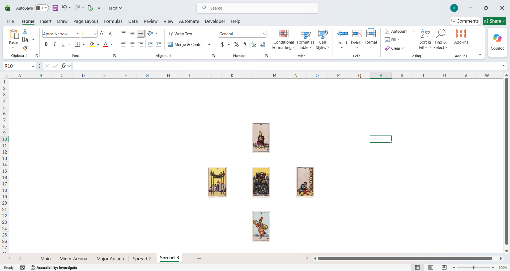
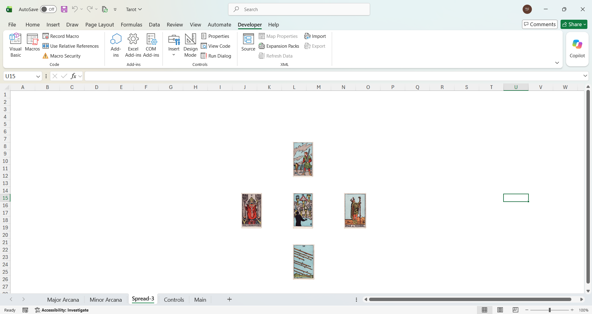
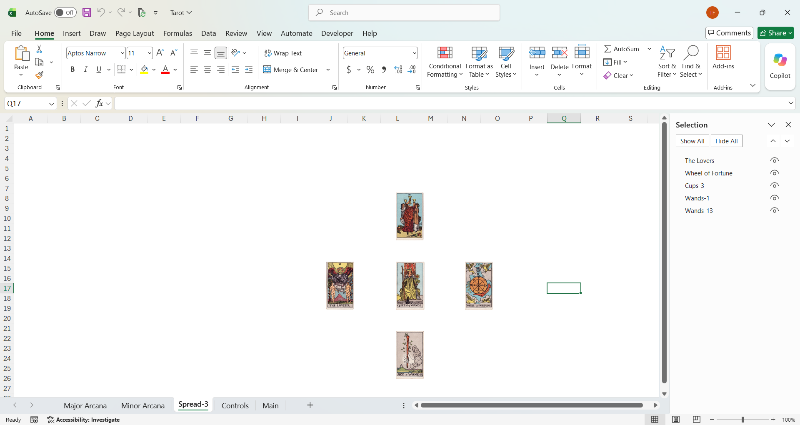

# Tarot

This is an Excel Application for creating Tarot speads.

## Screenshots

### Tarot Deck

### Spreads

#### Spread Three

#### Spread Three (Fixed)

#### Spread Three - The First Real Draw

## Project Contents

- Excel workbook containing the Tarot application.
- VBA modules supporting the application.
- Images and other supporting resources.

## Support

This project is currently under active development and unless you are one of my very special friends
you will receive no free support from me. 

Unless you are a competent developer, in which case
you will have to convince me that you have at least some idea of what you are talking about.
For example, at least be ready to explain to me how you would do a Full Factory Reset of
this app before you even think of bothering me.

## Warning

As for any practical uses that this Application may or may not have, I wouldn't even think of
touching it unless you are a true adept or an unusually courageous and foolhardy individual.
